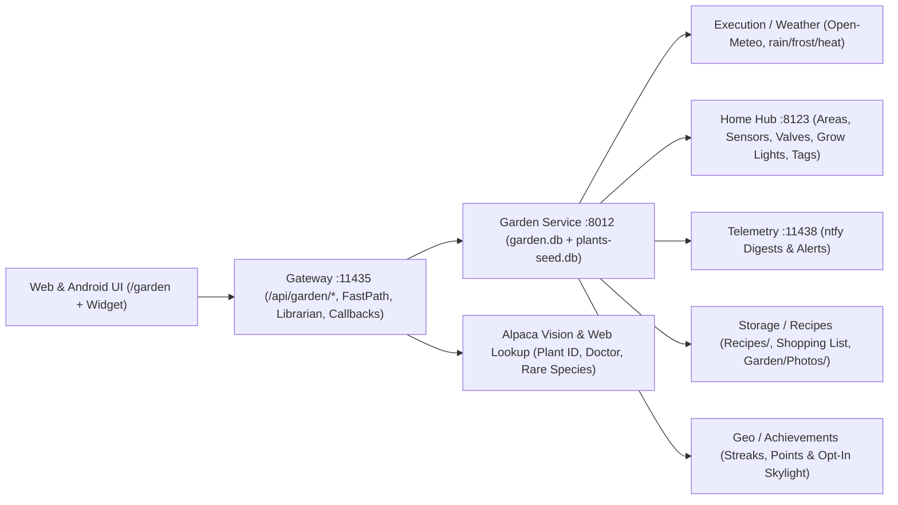

# Jarvis Garden: Plant, Herb & Garden Care

Status: **Phase 2 complete (2026-11-19)** — Family assignments, push digests, streaks & Skylite mirror built; Phase 3 complete (2026-11-19) — Weather-Smart Care & Unknown Species Lookup implemented.
Companion docs: [HEALTH_HUB.md](HEALTH_HUB.md) (sibling domain microservice and progressive-disclosure pattern),
[RECIPES.md](RECIPES.md) (shared cookbook, meal planning and shopping list),
[WEATHER.md](WEATHER.md) (Open-Meteo forecasts and `weather:events` bus),
[PUSH.md](PUSH.md) (self-hosted ntfy push and inline action callbacks),
[ROLES.md](ROLES.md) (family roles and permissions),
[ACHIEVEMENTS.md](ACHIEVEMENTS.md) (streaks, points and Skylight star bridge).

Goal: one local, free, family-first **Garden** hub (`/garden`) inside Jarvis that unifies
species-specific houseplant care, kitchen herb harvesting, family-sized outdoor garden planning,
harvest-driven recipes, and food preservation — replacing paid plant/garden apps with zero
subscriptions and zero cloud lock-in.

## 1. Locked Design Decisions

| Area | Decision |
| --- | --- |
| **Hub & service name** | Top-level **Garden** hub (`/garden`, `services/garden`, container `sharedllm_garden`, port **`8012`**) covering houseplants, kitchen herbs, and outdoor garden under one nav entry. |
| **Climate & zone** | Auto-detect USDA Hardiness Zone (`3a-11b`) and typical last-spring / first-fall frost dates from household lat/lon (Weather / Home Hub `zone.home`), with manual tweaking and microclimate overrides. |
| **Houseplant onboarding** | Fast-add with smart species defaults, optional **personal plant names** (e.g., *"Monty"* the Monstera, with playful name suggestions), optional pot/soil/window tuning, and self-calibrating watering cadence when tapping *"Still damp"*. |
| **Unknown / rare species** | 3-tier resolution: (1) offline `/data/plants-seed.db` first, (2) optional live open botanical lookup + *"Ask Jarvis to draft care profile"* (LLM/vision), (3) user reviews and saves permanently into local `custom_species`. |
| **Outdoor bed layouts** | Two-level hybrid: lightweight 2D **Yard Map** (beds, trellises, greenhouse, water spigots, N/S/E/W sun orientation) + tap any bed to open a mobile-friendly **Square-Foot Tap-to-Place Grid** with companion/antagonist/rotation checks and *"Auto-arrange"*. |
| **Family-size planning** | Dual mode: simple **Family Size + Fresh / Fresh+Preserve** presets (plus *"Let Jarvis propose a full plan"*) **and** expandable **Pantry-Goal Mode** (e.g., *"40 qt marinara, 20 pt salsa, 30 lbs frozen green beans"* -> back-calculates raw lbs, plant counts and sq ft). |
| **Harvest-driven recipes** | Match existing `Recipes/` cookbook first; when a surplus crop has few cookbook matches, offer *"Suggest / draft new family-sized recipe"* via Jarvis (saved to `Recipes/` only on approval, scaled to household servings). |
| **Preservation & pantry** | Preservation Advisor (methods, combo ideas, USDA safety callouts, Shopping List prep checklists) + lightweight **Put-Up Pantry** tracker (jars/bags/lbs preserved vs yearly goal, batch date, storage spot, use-first reminders). |
| **Family permissions** | **Open care, guarded structure:** everyone logs watering, harvests and photos; adults and admins add/edit plants and plans; parents/admins (`is_admin` or `family.manage`) manage assignments and Home Hub irrigation valves. |
| **Chores & rewards** | Jarvis Garden + Achievements streaks/points by default, with an opt-in per-assignment toggle to mirror a chore to Skylight. |
| **Notifications** | One quiet morning digest per person (their assigned + unassigned due tasks) with inline **Watered** / **Snooze** push buttons + immediate urgent alerts only for frost, heatwave, or valve/sensor anomalies. |
| **Photo storage** | Full plant ID, diagnosis and growth-journal photos stored in Nextcloud (`Garden/Photos/`, matching `Recipes/`) with fast local thumbnails in `services/garden` (graceful local fallback if Nextcloud is unavailable). |
| **Home Hub hardware** | **Progressive disclosure and strictly opt-in automations:** sensor, valve, grow-light, and NFC/QR tag UI stays hidden until matching entities exist in **Home Hub** (`services/homehub`). Valves default to *"Notify + one-tap Run"*, with opt-in Auto mode guarded by hard max-minutes, rain-skip interlock and failsafe shutoff. |

## 2. System Architecture

Follows the standalone domain microservice pattern established by `services/bible` (`8010`) and
`services/health` (`8011`):

- **Container:** `sharedllm_garden` (`services/garden`, port **`8012`**)
- **Databases:**
  - `/data/garden.db` (SQLite) — household profile, locations/yard map, plants, custom species
    cache, care rules and logs, harvest logs, pantry goals and put-up batches, seasonal plans,
    Home Hub bindings, and photo journal metadata.
  - `/data/plants-seed.db` (read-only SQLite botanical and crop catalog, mirroring Health Hub's
    `/data/fdc-seed.db`) — built offline via `scripts/build_plants_seed.py` with FTS5 search.
- **Auth & proxy:** Gateway proxies `/api/garden/*` with `X-Internal-Secret`, `X-User-Id`, and
  family role/permission claims (`is_admin`, `family_role`, `family.manage`) resolved from
  Identity.

### Reuse ("one implementation of everything")

| Need | Reuse in Jarvis |
| --- | --- |
| Weather, rain, frost, heat, GDD | Open-Meteo via `services/common/weather_client.py` and `weather:events` stream |
| Rooms, sensors, valves, NFC/QR tags | **Home Hub** (`services/homehub/main.py`, port `8123` + `services/homehub/registries.py`) |
| Push digests & inline action buttons | Telemetry (`11438`) -> ntfy -> Android (`jarvis_garden` channel) + `services/gateway/push_callbacks.py` |
| Cookbook, meal plan & shopping list | `Recipes/` (`services/gateway/cookbook.py`), `Recipes/Meal plan.md`, `services/ui/src/lib/shoppingList.ts` |
| Roles, streaks, points & chores | Identity roles ([ROLES.md](ROLES.md)), [ACHIEVEMENTS.md](ACHIEVEMENTS.md), opt-in Skylight chores |
| Voice, chat, vision & live lookup | Gateway FastPath + Librarian tools + Alpaca Vision + existing web lookup tool |
| Long-term photo storage | Nextcloud `Garden/Photos/` + local thumbnail cache in `services/garden` |

## 3. Core Data Model

### Read-Only Botanical Seed (`/data/plants-seed.db`) + Local `custom_species`

Curated starter catalog (~150-200 common houseplants, culinary herbs, vegetables, and fruits),
indexed with FTS5. User-approved live/AI-drafted species share the exact same schema in
`custom_species` inside `/data/garden.db`:

- **Species-specific houseplant care profile:**
  - *Watering:* active-season base interval, winter/dormant multiplier, **watering method**
    (`top_drain | bottom_water | soak_and_dry | evenly_moist | bark_soak | air_bath`), **soil
    dryness cue** (`surface_damp | top_1in_dry | top_2in_dry | mostly_dry | bone_dry`), and
    **water quality sensitivity** (`tap_ok | filtered_or_rain_preferred`).
  - *Environment & substrate:* light level (`low | medium | bright_indirect | bright_direct |
    full_sun`), ideal temp range and cold-draft sensitivity, humidity band (`low_tolerant |
    average | high_humidity`), **misting rule** (`beneficial | optional | avoid_misting`), and
    recommended soil mix (`standard_potting | chunky_aroid | cactus_succulent | orchid_bark |
    african_violet | moisture_retentive`).
  - *Lifecycle maintenance:* fertilizing type, dilution and active-season cadence (auto-paused in
    winter dormancy), repotting cadence (e.g., 1-2 yr fast growers vs 3-5 yr root-bound lovers),
    rotation cadence, leaf cleaning/grooming, support/pruning notes, and propagation methods.
  - *Safety & troubleshooting:* **pet and kid toxicity level** (`non_toxic | mild_irritant |
    toxic_pets | toxic_all` + notes), common species pests (spider mites, fungus gnats,
    mealybugs, scale), and quick symptom reference.
- **Outdoor / garden agronomy:** min/max USDA hardiness zone, frost tolerance (`tender |
  half_hardy | hardy`), germination soil temp, indoor seed-start / direct-sow / transplant offsets
  (weeks relative to last spring frost and first fall frost), **days to maturity**, harvest window
  duration, and tall/trellis flag (for north-side placement).
- **Family-size & pantry-goal math:** plants per sq ft (square-foot gardening grid), expected
  yield per plant / per sq ft (low/typical/high lbs), **preservation conversion ratios** (e.g.,
  lbs paste tomatoes per quart of marinara, lbs cucumbers per quart of pickles, lbs beans per
  quart frozen/canned), **crop family** (rotation), **companions** and **antagonists**.
- **Kitchen & preservation metadata:** culinary ingredient aliases (for matching `Recipes/`),
  preservation methods (`water_bath_canning`, `pressure_canning`, `freezing`, `dehydrating`,
  `fermenting`, `cold_storage`, `oil_herb_cubes`), USDA acidity class (`high_acid | low_acid`),
  blanching times, combo recipe tags, and required supplies.

### Household Store (`/data/garden.db`)

| Table | Purpose |
| --- | --- |
| `garden_profile` | `family_size` (the household roster from Identity, `GET /api/internal/household`, when a profile is created; an explicit value is the planner override), `hardiness_zone`, `zone_source` (`auto`, `manual`), `last_spring_frost_mmdd`, `first_fall_frost_mmdd`, `units`, `preservation_prefs`, `daily_digest_time`, `yard_canvas_json` (dimensions, compass/north angle, water spigots, walkways). |
| `custom_species` | Locally cached species created manually or via live botanical lookup + Jarvis AI draft (same schema as `plants-seed.db`, tagged with `source` and `reviewed_at`). |
| `locations` | The Garden's **own** places only: herb spots (`herb_station`), outdoor beds/structures (`raised_bed`, `in_ground`, `container`, `trellis`, `greenhouse`, `orchard`) with `width_ft`, `length_ft`, `area_sqft`, `sun_exposure`, `covered`, and 2D yard-map coordinates (`map_x`, `map_y`, `rotation_deg`). Indoor rooms are **not** here: they are Home Hub's areas (`GET/POST /hub/areas`), the house's one list of rooms, so `GET /locations` merges them in (`kind: indoor_room`, `source: homehub`, `id` = the hub `area_id`) and adding, renaming or removing a room is forwarded to the hub (`services/garden/hub_rooms.py`). A room the Garden made before that switch is adopted into the hub on the next read. With no `HOMEHUB_URL`, Garden falls back to its own rows and keeps working. |
| `plants` | Individual houseplants, herb pots, or outdoor crop plantings: `category` (`houseplant`, `herb`, `vegetable`, `fruit`, `flower`), `species_ref`, `location_id`, `nickname` (optional personal name such as *"Monty"* or *"Sir Basil"*, shown as primary title across UI, notifications and voice; falls back cleanly to species name if blank), `quantity`, `area_sqft_used`, potted/indoor attributes (`pot_size_in`, `pot_material`, `has_drainage`, `soil_mix`, `window_direction`, `distance_from_window`), `planted_date`, `last_repotted_date`, `planting_method`, `expected_harvest_start`, `expected_harvest_end`, `status`, `assigned_to`, `skylight_sync_enabled`, `notes`. |
| `care_rules` | Per-plant or per-location recurring actions (`water`, `fertilize`, `mist`, `clean_leaves`, `prune_pinch`, `rotate`, `repot`, `check_pests`, `weed`, `mulch`, `frost_protect`): `interval_days`, `winter_multiplier`, `calibration_factor`, `rain_skip_enabled`, `next_due_at`, `snoozed_until`, `paused`. |
| `care_logs` | Timestamped care history (`plant_id`/`location_id`, `action`, `performed_by`, `source`: `manual`, `voice`, `push_action`, `nfc_tag`, `rain_auto_skip`, `homehub_valve`, `notes`, optional sensor reading snapshot). |
| `harvest_logs` | Harvest records (`plant_id`, `harvested_at`, `harvested_by`, `quantity`, `unit`, `disposition`, `notes`); pushes yield metrics to `weather_client.push_metric()`. |
| `pantry_goals` | Yearly preservation targets (e.g., `item: "Marinara sauce"`, `crop_refs: ["roma_tomato", "basil", "garlic"]`, `target_qty: 40`, `unit: "quarts"`, `method: "water_bath_canning"`) that back-calculate required plant counts and track seasonal progress. |
| `pantry_batches` | Lightweight **Put-Up Pantry** log (`goal_id?`, `label`, `method`, `batch_date`, `qty_initial`, `qty_remaining`, `unit`, `storage_location`, `use_by_date`, `logged_by`, `notes`). |
| `garden_plans` & `plan_cells` | Seasonal bed plans (e.g., *Spring/Summer 2027*, *Fall 2027*) storing square-foot cell assignments `(bed_id, col, row, plant_id/species_ref)`, target family size, fresh vs preserving mode, and historical crop families per bed for multi-year rotation checks. |
| `homehub_bindings` | Phase 8: sensor/valve/tag bindings store only Home Hub **entity ids** (`soil_moisture_entity`, `temp_entity`, `humidity_entity`, `light_entity`, `valve_entity`, `grow_light_entity`, `nfc_tag_id`) plus Garden's own thresholds and strictly opt-in automation flags (`valve_mode`: `notify_only`, `confirm`, `auto`; `max_run_minutes`, `daily_max_runs`, `rain_interlock: true`). Entity names and areas are Home Hub's and are never copied here. |
| `plant_photos` | Photo journal metadata (`plant_id`, `nextcloud_path`, `thumb_path`, `taken_at`, `taken_by`, `kind`: `progress`, `id`, `diagnosis`, `ai_summary_json`). |

## 4. Feature Specification

### A. Species-Specific Houseplant Care

Every houseplant receives tailored care instructions and schedules adapted to **both its species
and its exact home spot**:

1. **Fast-add, personal names & personalized cadence engine:**
   - Adding a plant needs only **Species + Room** (with instant smart defaults) plus an optional
     **Personal Name** (e.g., *"Monty"* - Monstera deliciosa, *"Fernie"* - Boston Fern,
     *"Sir Basil"*), with an optional playful *"Suggest a name"* button. Personal names appear on
     plant cards, checklists, growth journals, and morning notifications (*"Monty and Fernie need
     water today"*), and can be renamed anytime.
   - Optional **Pot & Spot Tuning** (`pot_size_in`, `pot_material`, `has_drainage`, `soil_mix`,
     `window_direction`, `distance_from_window`) refines the schedule automatically (`species base
     x pot x soil x window x season/dormancy`).
   - **Actionable care cues on every task:**
     - *Snake Plant / ZZ Plant / Succulents:* wait until **bone dry** all the way down, then soak
       and drain completely.
     - *African Violet / String of Pearls:* **bottom-water** 15-20 min; keep leaves dry and never
       mist.
     - *Calathea / Spider Plant / Dracaena:* keep top 1 in lightly damp; use **filtered or
       rainwater** to avoid brown leaf tips.
     - *Moth Orchid (Phalaenopsis):* **bark soak** 10-15 min when roots turn silvery-grey; drain
       fully; keep water out of the crown.
     - *Air Plant (Tillandsia):* **20-30 min soak bath**, shake and dry upside-down.
   - **Self-calibrating snooze:** tapping **"Still damp (+2d)"** logs the check and nudges
     `calibration_factor` so Jarvis learns how fast that specific pot in that room dries.
   - **No-drainage guardrail:** warns to water sparingly and empty saucers/cachepots when
     `has_drainage = false`.
2. **Full houseplant lifecycle (beyond watering):**
   - **Light & placement fit:** compares species light needs against the plant's window/room and
     flags mismatches.
   - **Rotation, grooming & support:** 1/4-turn rotation for phototropic foliage, wiping dusty
     broad leaves, moss-pole/staking prompts, deadheading, and propagation tips.
   - **Humidity & misting rules:** recommends humidifier/pebble tray or misting only where
     beneficial; explicitly warns **never to mist** rot-prone species.
   - **Fertilizing & winter dormancy:** species-appropriate feed type and cadence in spring/summer;
     auto-pauses feeding and slows watering in winter.
   - **Repotting & soil mix:** tracks `last_repotted_date` and prompts spring root-bound checks
     based on species (1-2 yrs fast growers vs 3-5 yrs root-bound lovers).
   - **Species pests, symptoms & toxicity:** built-in pest watch-outs, symptom quick-guide, and
     prominent **Pet & Kid Toxicity** badges on every card.
3. **3-tier species lookup (offline -> live + AI draft -> cached locally):**
   - Searches `/data/plants-seed.db` first; if an uncommon plant or heirloom is missing, offers an
     optional live open botanical lookup + **Ask Jarvis** to draft a complete structured care
     profile for review, then saves it permanently to `custom_species`.

### B. Kitchen Herbs & Recipes Bridge

- **Herb-aware care:** pinching/pruning reminders to prevent bolting, "Ready to snip" status, and
  short regrowth cooldowns so pots recover.
- **"Fresh in Your Garden" -> Recipes:** matches currently harvesting herbs and produce against
  the family's `Recipes/` cookbook ingredients, adding a **"Use from garden"** filter/banner on
  `/recipes` and the weekly Meal Planner.
- **Surplus recipe drafting:** when a crop is peaking and the cookbook has few matches, offers
  *"Draft a new family-sized recipe"* via Jarvis, saved as standard Nextcloud markdown in
  `Recipes/` only when approved and scaled to household servings.
- **Smart Shopping List sync:**
  - When generating `Recipes/Shopping list.md` from the meal plan, flags items currently
    harvest-ready (*"Available in garden - skip buying?"*).
  - One-tap export of garden and preservation supplies (seeds, potting mix, compost, jars, new
    lids, pectin) to `Recipes/Shopping list.md`.

### C. Family-Sized Outdoor Garden Planner (2-Level Layout + Dual Sizing)

1. **Zone & frost engine:** auto-detects USDA Zone and spring/fall frost dates from household
   lat/lon with manual microclimate tweaking; filters crops by zone suitability and season length.
2. **Dual sizing mode:**
   - **Simple mode:** set `family_size` (e.g., 7) + `Fresh only` vs `Fresh + Preserving` for
     instant recommended plant counts and sq ft per crop, plus *"Let Jarvis propose a full
     seasonal plan"*.
   - **Pantry-Goal mode:** enter concrete annual preservation targets (*"40 qt marinara, 20 pt
     salsa, 24 pt dill pickles, 30 lbs frozen green beans"*) -> Jarvis back-calculates raw lbs
     needed, exact plant counts, and required sq ft using extension yield and conversion ratios,
     feeding them directly into the bed plan.
3. **Two-level visual layout:**
   - **Level 1 - 2D Yard Map:** lightweight snap-to-grid yard canvas showing raised beds,
     in-ground plots, trellises, greenhouse, water spigots, walkways, and compass N/S/E/W sun
     orientation (touch pan/zoom on phones, drag-and-drop on tablet/desktop).
   - **Level 2 - Square-Foot Bed Grid:** tap any bed to open its `width x length` sq-ft grid. Tap
     cells to place crops or tap **"Auto-arrange"** (places tall/trellised crops on the north
     side, pairs companions like basil + tomatoes, avoids antagonists like beans + onions, and
     checks multi-year crop-family rotation against prior seasons' plans).
4. **Seasonal timeline & Calendar sync:** generates dated milestones (*Start seeds indoors ->
   Harden off -> Transplant / Direct sow -> Expected harvest -> Fall succession*) with optional
   export to Jarvis Calendar.

### D. Harvest Forecast, Food Preservation & Put-Up Pantry

1. **Ripening & harvest forecast:** uses `planted_date + days_to_maturity` (refined with Growing
   Degree Days from Open-Meteo weather data) to show a rolling 2-4 week **"Coming Ready Soon"**
   timeline alongside matching family recipes.
2. **Food Preservation Advisor:**
   - Recommends preservation methods for everything planted: **Water-bath canning**, **Pressure
     canning**, **Freezing** (with blanching times), **Dehydrating**, **Fermenting**,
     **Root-cellar/curing**, and **Herb drying / olive-oil cubes**.
   - **Combo preservation ideas** based on crops growing together (*tomatoes + peppers + onions +
     cilantro -> salsa*; *tomatoes + basil + garlic -> marinara*; *cucumbers + dill + garlic ->
     dill pickles*; *basil + garlic -> pesto cubes*).
   - **USDA safety guardrails:** explicitly distinguishes high-acid (water-bath safe) vs low-acid
     foods (pressure canner required) and directs users to tested USDA/NCHFP/Ball ratios rather
     than inventing untested canning recipes.
   - **Advance prep checklists:** 2-3 weeks before peak harvest, generates supply checklists
     (jars, new two-piece lids, citric acid, pectin, freezer bags, pickling salt) with one-tap
     export to Shopping List.
3. **Put-Up Pantry tracker:**
   - Log actual preserved batches (*"12 quarts marinara - Water-bath canned - Basement shelf - Use
     by Oct 2027"*).
   - Tracks progress bars against `pantry_goals` (*"28 / 40 qt marinara put up"*), lets household
     members decrement jars/bags as they are used, and surfaces gentle **"Use first"** reminders.

### E. Weather-Smart Care (Open-Meteo + `weather:events`)

- **Rain skip (uncovered outdoor beds only):** checks observed rain (last 24h) + upcoming 12h
  forecast; defers outdoor watering with a logged `rain_auto_skip` note (never skips indoor
  houseplants or covered pots).
- **Heatwave boost:** high temps + low humidity shorten outdoor/container watering intervals and
  suggest early-morning watering and mulch checks.
- **Plant-specific frost & wind alerts:** subscribes to `weather:events` and filters active
  outdoor plants by `frost_tolerance` so alerts name exactly what to cover or bring inside vs
  what is hardy.

### F. Family Roles, Chores & Notifications

- **Permissions (`services/identity` roles):**
  - *Everyone (`child`, `teen`, `adult_child`, `mother`, `father`, `admin`):* view garden, log
    watering/care/harvests, log Put-Up Pantry usage, upload photos.
  - *Adults & Admins (`adult_child`, `mother`, `father`, `admin`):* add/edit plants, beds,
    seasonal plans, pantry goals and batches.
  - *Parents & Admins (`is_admin` or `family.manage`):* assign plants/beds to family members,
    toggle Skylight chore sync, bind and control Home Hub irrigation valves/automations.
- **Notifications (Telemetry -> ntfy -> Android `jarvis_garden` channel):**
  - **One quiet morning digest per person** (sent only when they have assigned or unassigned due
    tasks), with inline `push_callbacks.py` buttons: **`Mark Watered`** (`garden_done`) and
    **`Still damp (+1d)`** (`garden_snooze`).
  - **Immediate urgent alerts** only for frost/freeze, extreme heat/wind, or Home Hub valve/sensor
    anomalies.
- **Motivation & chores:** garden streaks and badges in `achievements.json` (*Green Thumb*, *7-Day
  Watering Streak*, *First Harvest*, *Master Preserver*) + opt-in per-assignment toggle to mirror
  a watering chore to Skylight.

### G. Jarvis Voice, Chat & Camera (Alpaca Vision)

- **FastPath (Tier 1, <100 ms):** resolves plants by **personal name, species, or room** — *"I
  watered Monty"*, *"I watered the monstera"*, *"I watered all the living room plants"*, *"What
  plants need water today?"*, *"Snooze Fernie until tomorrow"*, *"Log 3 pounds of tomatoes
  harvested"*.
- **Librarian tools (Tier 2):** grounded in live garden state (including personal names), weather,
  cookbook and pantry goals (`garden_summary`, `garden_log_care`, `garden_log_harvest`,
  `garden_recipe_matches`, `garden_preservation_guide`, `garden_plan_suggest`).
- **Alpaca Vision (Camera):**
  - **Snap to Add:** photo of a plant or seed packet identifies species and pre-fills care data.
  - **Plant Doctor:** photo of drooping/yellowing/spotted leaves + recent care history +
    weather/sensor context -> diagnosis and recovery plan saved to the plant's timeline.
  - **Growth Journal:** full-res photos in Nextcloud `Garden/Photos/` with fast thumbnails in
    `services/garden`.

### H. Home Hub Integration (Progressive Disclosure & Opt-In Automations)

Built directly on **Home Hub** (`services/homehub`, port `8123`):

- **Clean when absent:** if Home Hub has no plant sensors, irrigation valves, grow lights, or
  NFC/QR tags, **all hardware and automation UI stays hidden**.
- **Automatic discovery:** as soon as a matching entity appears in Home Hub (ESPHome, BLE soil
  sensor, Matter/Zigbee valve, grow light, NFC tag), its binding controls appear on the plant/bed
  detail view.
- **Strictly opt-in automations:**
  - *Sensors (`sensor.*`):* live moisture/temp/humidity/lux on cards; opt-in toggle to let
    moisture thresholds override schedule guesses.
  - *Irrigation valves (`valve.*` / `switch.*`):* default to **`notify_only`** (*"Bed 1 is dry -
    tap to run valve 10 min"*). **`auto`** mode is opt-in per bed and requires hard
    `max_run_minutes`, `daily_max_runs`, rain-skip interlock, and failsafe shutoff + urgent alert
    if a valve remains open past its timer.
  - *Grow lights (`light.*`):* opt-in photoperiod schedules (e.g., 14-16h/day for seedlings).
  - *NFC/QR pot & bed tags (`tags` registry):* scan a tag on a pot or raised bed to open that
    plant or log *"Watered"* in one tap.

## 5. Mobile-First UI Design (`/garden`)

Follows Jarvis's **Glance -> Focus -> Explore** mobile layout (44 px minimum touch targets):

1. **Today tab:** weather/frost banner (when relevant); **Due Today** grouped by *Houseplants*,
   *Herbs*, and *Outdoor Garden* with personal names and species cues (*"Bottom-water - top 2 in
   dry - filtered water"*), one-tap **Done**, **Still damp (+2d)**, and **Water whole room**;
   **Ready to Harvest** strip; quick camera FAB.
2. **Plants tab:** filters (*All / Houseplants / Herbs / Outdoor*, Room/Bed, Mine); cards with
   thumbnail, personal name + species subtitle, status dot, next due, pet-safe badge, assigned
   family avatar, and conditional Home Hub moisture pill; **Plant Detail** with full **Species
   Care Sheet**, pot/placement settings, care log, photo journal, conditional Home Hub binding
   card, and quick Diagnose.
3. **Planner tab:** Household Climate card (family size, USDA Zone auto/override, frost dates);
   **2D Yard Map** -> tap any bed for its **Square-Foot Grid** with companion/antagonist/rotation
   checks and **Auto-arrange**; **Family Sizing & Pantry Goals** drawer; **Planting Calendar**.
4. **Harvest & Pantry tab:** **Log Harvest** + seasonal totals; **Coming Ready & Matching
   Recipes** (3-week forecast + `Recipes/` matches + *"Add to Meal Plan"* / *"Draft new family
   recipe"*); **Preservation Planner & Put-Up Pantry** (guides, combos, USDA safety notes,
   Shopping List prep checklists, and progress bars with *"Use first"* badges).
5. **Dashboard Widget (`GardenTodayWidget`):** compact summary card showing due count, frost/rain
   chip, and ready-to-harvest herbs/veggies.

## 6. Phased Delivery Roadmap

| Phase | Milestone | Key Deliverables |
| --- | --- | --- |
| **Phase 0** | **Botanical Seed & Docs** | [PLANT_CARE.md](PLANT_CARE.md) (this doc); `data/plants_seed/{houseplant,herb,vegetable,fruit}.json` curated catalog (159 species: 55 houseplants, 20 herbs, 49 vegetables, 35 fruits — no hardcoded Python lists); `data/plants_seed/fields.py` shared schema/enums/safety rules (`KNOWN_LOW_ACID_KEYS` = 9 low-acid vegetables requiring pressure canning; `winter_multiplier` = interval multiplier >= 1.0, `winter_days = interval * multiplier`; frost offsets: positive = weeks before last frost, negative = after); `scripts/build_plants_seed.py` -> `data/plants/plants-seed.db` (FTS5 + count/schema/safety/canning-frost-winter assertions; atomic `.building` replace; meta stores actual `catalog_dir`); `services/garden/plant_seed.py` read-only reader (all `fields.COLUMNS` exposed; `search`/`list_by_category` with optional `category` and `usda_zone` filters; lazy read-only URI, `_absent` flag, FTS5 `bm25`); `services/garden/__init__.py`; unit tests incl. negative tests (low-acid pressure canning, tender crop frost offsets, winter_multiplier >= 1.0, known-toxic never non_toxic, missing required). |
| **Phase 1** | **Species-Smart Houseplants MVP & Service Skeleton** | `services/garden` (port `8012`, `/data/garden.db`), `docker-compose.yml` + Gateway `/api/garden/*` proxy + role guards, rooms & plant CRUD, personal naming, fast-add + optional pot/soil/window tuning, adaptive cadence engine + self-calibrating *"Still damp"* snooze, full Species Care Sheet, mobile UI (`Today` + `Plants` tabs) + `GardenTodayWidget`. [DONE 2026-11-19: `services/garden/{models,cadence,main}.py`, `Dockerfile`, `requirements.txt`, `README.md`, `tests/`; `services/config.py` GARDEN_SVC_URL; `docker-compose.yml` sharedllm_garden; `services/gateway/garden_routes.py`; `services/ui/src/pages/Garden.tsx`, `components/garden/`, `widgets/GardenTodayWidget.tsx`; 61 backend tests pass, 9 vitest tests pass, tsc 0 errors.] |
| **Phase 2** | **Family Chores, Push & Streaks** | Parent/admin assignments, Telemetry/ntfy quiet morning digest (`jarvis_garden` channel), inline `garden_done` & `garden_snooze` push callbacks, garden achievements/streaks, opt-in per-assignment Skylight chore mirror. [DONE 2026-11-19: `services/garden/main.py` (`_require_parent_or_admin`, `PATCH /locations/{id}/assign`, `PATCH /plants/{id}/assign` with `model_fields_set` null-unassign, `PATCH /plants/{id}` & `/locations/{id}` parent+ guard on assignment fields, `GET /today` with paused-rule exclusion + effective assignment + `?mine` semantics, `GET /streaks` with achievements, `POST /notices/test` with real Telemetry dispatch); `services/garden/notices.py` (`build_digest` with real callback params, `collect_due_tasks` with UTC + effective assignment, `digest_loop` in lifespan, `send_digest_to_member` via Telemetry); `services/garden/skylight_sync.py` (`mirror_care_log` calls Execution's Skylight complete endpoint, degrades gracefully); `services/garden/achievements.py` (loads/evaluates `achievements.json`); `services/garden/achievements.json` (10 achievements); `services/gateway/garden_routes.py` (`/assign`, `/streaks`, `/notices/test`, forwards `?mine`/`?assigned_to`); `services/gateway/push_callbacks.py` (`garden_done` with `plant_ids` support, `garden_snooze`, reuse `_verified_headers`/`_call`, no spoofable headers); `services/telemetry/notices.py` (`KNOWN_CATEGORIES` includes `garden`); `services/ui/src/lib/notificationCategories.ts` (`garden` category); `services/ui/` (`All`/`Mine` filter pill on Today+Plants, Care Streak pill, `stopPropagation` on Skylight checkbox, `PlantDetail` assignment selector + Skylight toggle parent+ only, Digest Settings modal); 81 backend tests pass, 13 vitest tests pass, tsc 0 errors.] |
| **Phase 3** | **Weather-Smart Care & Unknown Species Lookup** | `weather_client.py` + `weather:events` subscriber (rain-skip for uncovered outdoor beds, heatwave boost, plant-specific frost/wind alerts); 3-tier unknown species lookup (live open botanical lookup + Jarvis AI care draft -> cached in `custom_species`). [DONE 2026-11-19: `services/garden/weather_care.py`, `services/garden/species_lookup.py`, `services/garden/main.py` (weather on `/today`, `rain_skip` on `create_plant`, `resolve_species`, `/hooks/weather`, `/species/lookup`, `/species/custom`, `DELETE /species/custom/{key}`), `services/garden/cadence.py` (`heat_factor`), `services/garden/models.py` (`CustomSpecies`), `services/garden/tests/test_phase3.py` (29 tests); `services/gateway/garden_routes.py` (+ proxy tests); `services/ui/src/pages/Garden.tsx` (weather banner, lookup flow), `services/ui/src/services/api.ts`, `services/ui/src/types/api.ts`, `services/ui/src/pages/Garden.test.tsx` (7 new tests); 114 backend tests pass, 20 vitest tests pass, tsc 0 errors.] |
| **Phase 4** | **Kitchen Herbs, Harvest Log & Recipes Bridge** | Herb pinching/regrowth tracking, Harvest Log, `Recipes/` cookbook ingredient matcher (*"Use from garden"*), Jarvis surplus recipe drafting (scaled to family size), Shopping List garden-dedupe & supply export. [DONE 2026-11-20: `services/garden/models.py` (HarvestLog table + Plant last_harvested_at/regrowth_cooldown_days, HarvestLogIn/Out schemas); `services/garden/cadence.py` (herb prune_pinch auto-seed); `services/garden/main.py` (POST /plants/{id}/harvest all roles, GET /harvests, DELETE /harvests/{id}, GET /harvest/ready, GET /today ready_to_harvest, GET /streaks harvests_total); `services/garden/tests/test_phase4.py` (20 tests); `services/gateway/garden_routes.py` (+6 proxy routes); `services/gateway/garden_recipes.py` (recipe_matches word-boundary matching, recipe_draft LLM drafting); `services/gateway/tests/test_garden_recipes.py` + proxy tests; `services/ui/` (types, api.ts, Garden.tsx harvest modal/recent harvests, ShoppingList "In your garden" badge, RecipeBrowser garden filter, shoppingList.ts matchGardenItems); 134 backend tests pass, 41 gateway tests pass, tsc 0 errors, vitest 20/20.] |
| **Phase 5** | **Family-Sized Outdoor Garden Planner** | Auto USDA Zone & frost engine (with manual override), 2D Yard Map + Square-Foot Bed Grid, dual sizing (family presets + Pantry-Goal back-calculator), companion/antagonist & multi-year crop rotation checks, *"Auto-arrange"*, seasonal timeline + Calendar sync. [DONE 2026-11-20: `services/garden/models.py` (PantryGoal, GardenPlan, PlanCell tables + In/Out schemas); `services/garden/planner.py` (zone_number/zone_letter/zone_sort_key/zone_in_range/season_length_days, default_frost_dates/frost_offset_weeks/add_weeks, preservation_raw_lbs/plant_count_for_raw_lbs/sqft_for_plants, crop_family/companion_list/antagonist_list/check_companions, auto_arrange_bed, planting_milestones, simple_sizing/pantry_goal_backcalc); `services/garden/main.py` (17 Phase 5 routes: detect-zone, pantry-goals CRUD + calculate, plans CRUD, plan cells CRUD, auto-arrange, checks, timeline, planner/sizing); `services/gateway/garden_routes.py` (17 proxy routes); `services/gateway/tests/test_garden_proxy.py` (12 new Phase 5 proxy tests); `services/ui/` (types/api.ts Planner types, services/api.ts Planner API methods, `components/garden/PlannerPanels.tsx` — Zone/Frost header with Auto-detect + Edit, dual sizing and Pantry-Goal back-calculation, plans management, 2D yard map, square-foot bed grid with Auto-arrange, seasonal timeline; `e2e/layout/garden.spec.ts` audits all five chromium form factors); 212 backend tests pass (incl. 31 in `test_phase5.py`), 53 gateway tests pass, tsc 0 errors, vitest 58/58 pass, build successful.] |
| **Phase 6** | **Harvest Forecast, Food Preservation & Put-Up Pantry** | Maturity & GDD harvest forecasting, Preservation Advisor (methods, combo ideas, USDA safety callouts, Shopping List prep checklists), and Put-Up Pantry batch tracker with goal progress & use-first reminders. [DONE 2026-11-20: `services/garden/models.py` (`PantryBatch` table + `PantryBatchIn`/`PantryBatchOut`/`PantryBatchPatch`/`PantryBatchUseIn` schemas, auto-migrated by `add_missing_columns`); `services/garden/preservation_combos.json` (data-driven methods, USDA safety copy, method aliases, supply categories, 10 combos); `services/garden/preservation.py` (`gdd_base_f` 50/40 °F by frost tolerance, `estimate_ready_date` self-consistent GDD model that degrades to `planted_date` + `days_to_maturity` with `gdd_adjusted: false`, `compute_harvest_forecast`, `method_key`, `build_preservation_advice`, `match_combos`, `build_prep_checklist`, `convert_qty`, `suggest_use_by`, `batch_flags`, `goal_progress`, `build_pantry_view`); `services/garden/main.py` (7 Phase 6 routes: `GET /harvest/forecast`, `GET /preservation/advice`, `GET/POST /pantry-batches`, `PATCH` and `DELETE /pantry-batches/{id}`, `POST /pantry-batches/{id}/use` open to every role); `services/gateway/garden_routes.py` (7 proxy routes); `services/garden/tests/test_phase6.py` (39 tests) + 9 Phase 6 proxy tests; `services/ui/src/components/garden/PantryPanels.tsx` + `Garden.tsx` Pantry tab (Coming Ready Soon, USDA callouts, combo cards, goal progress bars, use-first strip, log/edit batch modal, -1 Used for all roles, prep-supplies picker); `e2e/layout/garden.spec.ts` audits the tab on all five chromium form factors; 39 backend Phase 6 tests pass, 54 gateway proxy tests pass, tsc 0 errors, vitest 46/46 in `Garden.test.tsx`.] |
| **Phase 7** | **Jarvis Voice, Chat & Alpaca Vision** | Tier 1 FastPath watering/harvest commands (by personal name, species, or room), Tier 2 Librarian garden tools, camera Plant ID (snap-to-add), Plant Doctor sick-leaf diagnosis, Nextcloud `Garden/Photos/` storage + local thumbnails for growth journal. [DONE 2026-11-20: `services/garden/models.py` (`PlantPhoto` + `PlantPhotoIn`/`PlantPhotoOut`); `services/garden/main.py` (`GET /plants/resolve` declared before `/plants/{...}` with personal-name > species > room ranking, plurals and room phrases, and `ambiguous` instead of a guess; photo list/create/thumb/delete — everyone may add, the photographer or an adult may delete, thumbnails under `/data/thumbs/`); `services/execution/schemas.py` (`OcrRequest.context`, `PhotoUploadRequest`), `handlers/vision_ocr.py` (`plant_identify` + `plant_diagnose` tasks with their JSON prompts, structured pass-through, context), `handlers/storage.py` + `main.py` (`/execute/photo_upload`: Nextcloud folder + Pillow thumbnail, so Garden never holds Nextcloud credentials); `services/gateway/garden_assist.py` (resolve, `log_care`, `log_harvest`, `summarize` — one implementation for voice, routes and tools); `services/gateway/fast_garden.py` (Tier 1: watered by name/species/room, snooze/still damp, today summary, spoken harvests, ambiguity asks); `services/gateway/garden_vision.py` (identify + diagnose on `/execute/ocr`, `VisionUnavailable` naming `vision_ocr_model`); `garden_routes.py` (4 assistant routes, `vision/identify`, `diagnose`, photo proxies); `tool_registry.py` (6 garden tools -> the gateway routes); `services/ui/` (`components/garden/PhotoJournalPanel.tsx`, snap-to-add in `AddPlantModal`, Plant Doctor + journal in `PlantDetail`, 7 vitest cases, e2e mocks and the journal audited on all five form factors); `services/garden/tests/test_phase7.py` (21), `services/gateway/tests/test_fast_garden.py` (17), `services/gateway/tests/test_garden_vision.py` (18).] |
| **Phase 8** | **Progressive Home Hub Sensors, Valves & Tags** | Auto-hide hardware UI until entities exist in `services/homehub`; opt-in moisture/temp/humidity/lux sensor overrides, grow-light schedules, guarded irrigation valves (`notify_only` default, opt-in `auto` with hard safety caps & rain interlock), and Home Hub NFC/QR pot/bed tags. [DONE 2026-11-20: `services/garden/models.py` (`HomeHubBinding` on `garden_homehub_bindings` — entity ids and tag ids only, never a name or a state — plus `HomeHubBindingIn`/`Out` and `ValveRunIn`); `services/garden/homehub_hardware.py` (discovery over `/api/states` + `/hub/tags` with a 15 s cache and `has_any_hardware` as the one progressive-disclosure flag; per-reading snapshots that tolerate `unavailable`; the opt-in moisture verdict: dry forces due, `threshold + 15` holds off, an offline sensor falls back and says so; the guarded runner — caps re-checked, daily count read from `care_logs` with `source="homehub_valve"`, 409 rain interlock for an uncovered bed with a parent-only `override_rain`, one urgent parents-only Telemetry notice per stuck run; the failsafe watchdog and grow-light photoperiod loops, both disabled under pytest); `services/garden/main.py` (7 routes: `hardware/discover`, `bindings` GET/PUT/DELETE, `valve/run`, `valve/stop`, `tags/{tag_id}`; `_record_care` and `_water_location_plants` extracted so the care button, a room watering **and** a valve run share one implementation; `/today` + `_plant_out` carry `live_moisture_pct` and `held_by_moisture` with zero hub calls when nothing is bound); `weather_care.rain_state`/`is_outdoor_uncovered` (the interlock asks the same rain the plan does); `services/gateway/garden_routes.py` proxies all 7; `services/ui/` (`components/garden/HomeHubBindingPanel.tsx` — renders `null` with no hardware, read-only readings for everyone, valve/grow-light/tag editors and Run/Stop with the caps in view for parents; `TagScanCard.tsx` on `/garden?tag=`; `💧` pill on `PlantCard`; 5 vitest cases; hardware-present e2e mocks so the panel is audited on all five form factors); `services/garden/tests/test_phase8.py` (42), `services/gateway/tests/test_garden_librarian_tools.py` (17), 9 new proxy tests. |
